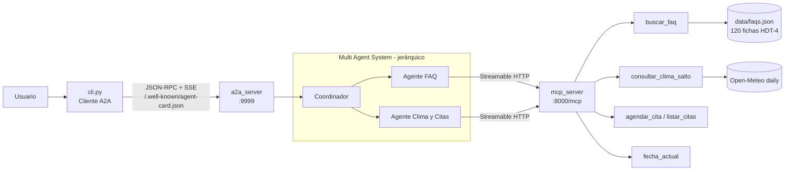

# AI-HDT7 — Parachute S.A. con MCP + A2A

Evolución de HDT-5/HDT-6: las herramientas de los agentes (FAQ, clima de salto y
agenda) se abstraen en **un solo servidor MCP** (transporte **Streamable HTTP**) y
el sistema multiagente se expone como **un solo agente A2A** con tres *skills*.
La terminal ahora es un **cliente A2A**.

## Arquitectura



| Componente | Archivo | Rol |
|---|---|---|
| Dominio | `parachute/` | FAQ, reglas de seguridad y agenda (lógica de HDT-5, sin cambios de criterio) |
| Servidor MCP | `mcp_server/server.py` | 5 herramientas, log por cada ejecución (args, resultado, ms) |
| MAS | `a2a_server/mas.py` | Coordinador + 2 especialistas; consumen MCP, no implementan lógica |
| Servidor A2A | `a2a_server/server.py` | Agent Card con skills `faq`, `clima-salto`, `agendar-cita`; tareas con estado y artefactos |
| Cliente A2A | `cli.py` | Descubre la Agent Card y conversa en streaming manteniendo `context_id` |

### Motores del MAS

- **`openai-agents`** (si existe `GROQ_API_KEY` u `OPENAI_API_KEY`, leídas de `.env`): OpenAI Agents SDK.
  Con Groq se usa `OpenAIChatCompletionsModel` sobre `BASE_URL` y `MODEL`
  (por defecto `openai/gpt-oss-120b`); ver `.env.example`. El coordinador usa
  `as_tool()` sobre los especialistas; cada especialista se conecta al MCP con
  `MCPServerStreamableHttp` y un `tool_filter` con solo sus herramientas. Modelo
  configurable con `MODEL` (Groq) u `OPENAI_MODEL`.
- **`rule-based`** (sin clave): mismo organigrama, enrutamiento determinista por
  intención y fechas (ISO, `dd/mm/aaaa`, hoy/mañana/día de la semana). Llama las mismas
  herramientas MCP con el cliente oficial `mcp.Client`.

Forzar uno: `PARACHUTE_AGENT_MODE=openai|rule-based|auto` (por defecto `auto`).

## Instalación

```bash
python3 -m venv .venv
.venv/bin/pip install -r requirements.txt
.venv/bin/python -m pytest -q        # 15 pruebas, sin red
```

## Ejecución (3 terminales — así se graba el video)

```bash
# 1) Servidor MCP  → http://127.0.0.1:8000/mcp
.venv/bin/python -m mcp_server.server

# 2) Servidor A2A  → http://127.0.0.1:9999  (Agent Card en /.well-known/agent-card.json)
cp .env.example .env                 # colocar GROQ_API_KEY; sin clave usa el motor rule-based
.venv/bin/python -m a2a_server.server

# 3) Terminal cliente A2A
.venv/bin/python cli.py
```

Alternativa: `./run_servers.sh` levanta 1 y 2 juntos (logs también en `logs/`).

### Variables útiles

| Variable | Uso |
|---|---|
| `PARACHUTE_WEATHER_FIXTURE=fixtures/favorable.json` | Clima simulado (también `marginal`, `rechazado`) para demostrar una reserva exitosa sin depender del pronóstico real |
| `PARACHUTE_TODAY=2026-10-17` | Fecha de referencia fija para el límite de 16 días |
| `MCP_URL`, `A2A_URL` | Endpoints si no se usan los puertos por defecto |

Estas variables se aplican al **servidor MCP**, que es donde vive la lógica.

## Guion sugerido para el video

1. Terminal 1: arrancar MCP; mostrar `Servidor MCP 'parachute-tools' ... (Streamable HTTP)`.
2. Terminal 2: arrancar A2A; mostrar `MAS '...' usando MCP` y abrir
   `curl -s localhost:9999/.well-known/agent-card.json | python -m json.tool`.
3. Terminal 3: `python cli.py` y preguntar:
   - `¿Cuál es el peso máximo para saltar?` → FAQ con cita `[FAQ-021]`.
   - `¿Cómo está el clima para saltar mañana?` → evaluación Open-Meteo con URL citada.
   - `¿Puedo saltar el 2026-12-20?` → corrección: fuera de los 16 días.
   - `Quiero agendar una cita para el <fecha>` → pide nombre → `Ana López` → reserva o rechazo por clima.
   - `ver mis citas`.
4. Señalar en cada consulta: log `tool #N → ... ✓ ... (ms)` en MCP y
   `tarea ... → ruta=coordinador → ...` en A2A.

Para mostrar una reserva aceptada en temporada de lluvia, reiniciar el MCP con
`PARACHUTE_WEATHER_FIXTURE=fixtures/favorable.json` (o `marginal.json`).

## Video de demostración

`docs/demo.mp4` (≈75 s, sin audio) muestra en una sola pantalla dividida con `tmux`:

1. **Servidor MCP** arrancando y emitiendo `tool #N → … ✓ … (ms)` por cada herramienta ejecutada.
2. **Servidor A2A** arrancando con el MAS (`openai-agents (groq: openai/gpt-oss-20b)`), sirviendo
   la Agent Card y registrando `tarea … → ruta=coordinador → agente_…`.
3. **Terminal cliente A2A**: lee la Agent Card (3 skills) y conversa: FAQ, clima de mañana,
   fecha fuera de rango, intento de reserva en dos turnos (el agente revisa el clima y no agenda
   porque el pronóstico real trae lluvia) y listado de citas.

Usa Open-Meteo real (sin fixtures); en la fecha de grabación (2026-10-17) ningún día del
pronóstico era apto, por eso la reserva se rechaza. Para mostrar una reserva aceptada, arrancar
el MCP con `PARACHUTE_WEATHER_FIXTURE=fixtures/favorable.json`. Las esperas de Groq se recortan
a 2.5 s al renderizar. Se grabó con `MODEL=openai/gpt-oss-20b` porque la cuota diaria gratuita
de Groq para `gpt-oss-120b` (200 000 tokens/día) se agotó durante las pruebas; ambos modelos funcionan.

Regenerarlo (requiere `tmux`, `asciinema`, `ffmpeg` y [`agg`](https://github.com/asciinema/agg)):

```bash
PAUSE=15 scripts/record_demo.sh docs/demo.cast   # PAUSE: segundos entre preguntas (límite de Groq)
agg --idle-time-limit 2.5 --font-size 14 --fps-cap 15 docs/demo.cast docs/demo.gif
ffmpeg -i docs/demo.gif -movflags faststart -pix_fmt yuv420p \
       -vf "scale=trunc(iw/2)*2:trunc(ih/2)*2" docs/demo.mp4
```

## Cambios respecto a HDT-5

- Clima con la opción **`daily`** de Open-Meteo en `America/Guatemala`
  (`wind_speed_10m_max`, `wind_gusts_10m_max`, `temperature_2m_max`,
  `precipitation_sum`, `cloud_cover_mean`) en lugar de la primera hora UTC.
- FAQ con el corpus real de Parachute S.A. (120 fichas de HDT-4) y normalización de acentos.
- Nueva herramienta de agenda que **revisa el clima antes de reservar** y persiste en `data/appointments.json`.
- Rango de pronóstico: 16 días **contando hoy** (último día consultable = hoy + 15). Si Open-Meteo
  devuelve `null` en alguna variable, el estado es `unavailable` y no se agenda (antes un `null`
  se leía como 0 y el día parecía favorable).
